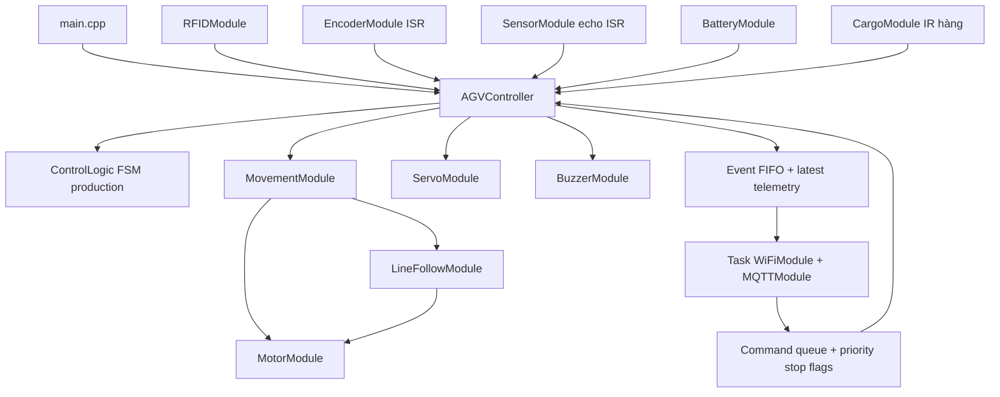

# Kiến trúc firmware và hệ thống

main.cpp chỉ gọi begin/update. AGVController sở hữu module và quyết định hành động qua ControlLogic. RFID, encoder và MQTT không gọi motor. ControlLogic/CommandCodec không phụ thuộc Arduino nên native test chạy trực tiếp production code.

Task mạng core 0 sở hữu WiFi connect/retry và PubSubClient; controller chạy Arduino loop. Queue FreeRTOS chuyển lệnh/snapshot, atomic flags chuyển stop khẩn cấp. Reconnect có thể chờ TCP trong task mạng nhưng không giữ loop cảm biến. Heartbeat stale của worker cũng làm MQTT health false.

## Trạng thái và nhiệm vụ

| Sự kiện | Hành vi |
| --- | --- |
| Boot | Motor PWM=0, servo không đặt góc; IDLE hoặc SAFE_STOP nếu mất mạng đã vượt timeout |
| TASK hợp lệ | Lưu path có giới hạn, WAITING; không tự chạy |
| START hợp lệ | Node RFID phải khớp node path hiện tại, đủ calibration, mạng và sensor; MOVING hoặc LOADING nếu ở pickup |
| Node tiếp theo | RFID xác nhận đúng thứ tự; chụp/reset hai encoder; AGV_REACHED_NODE với khoảng cách đoạn trước |
| startNode | Dừng motor, báo IR hàng tại pickup, chờ LIFT_UP đúng task/node; hai servo nâng rồi kiểm IR, chờ NODE_ORDER lùi/đi tiếp |
| targetNode cuối path | Dừng motor, chờ LIFT_DOWN đúng task/node; hai servo hạ; IR LOW ổn định mới COMPLETED -> IDLE |
| Thiếu NODE_ORDER | WAITING, motor dừng; lệnh hợp lệ đến sau mới đi tiếp nếu chưa STOP/lỗi |
| Lùi từ K1 về G1 | Chỉ cho đoạn quay về G ngay trước K trong path, line 000 dừng; còi ON khi cả hai motor lùi; RFID G1 mới kết thúc lùi, dừng 150 ms trước đoạn sau |
| Đang chở mà IR LOW ổn định | Motor dừng, SAFE_STOP/CARGO_LOST và ERROR server |
| STOP hoặc mất mạng trong grace | Motor dừng, nhiệm vụ WAITING; kết nối lại không tự chạy |
| Emergency stop / mất mạng quá timeout / obstacle / invalid sensor / lost line | SAFE_STOP latch, PWM=0; lỗi còn giữ |
| RESTART hợp lệ | Xóa latch về WAITING/IDLE, vẫn dừng; START là lệnh riêng |
| Quay bị gián đoạn | Không tự đoán hướng; CANCEL_TASK, định vị lại, RESTART và route mới |
| CANCEL_TASK | Xóa task và dừng motor; không xóa SAFE_STOP/ERROR |

Line 010/101/111 tiến; 100/110 chỉ chạy bánh trái, 001/011 chỉ chạy bánh phải; chỉ 000 gây LINE_LOST/SAFE_STOP. Driver L298N và chiều tiến hai bên đã tích hợp từ profile thử, nhưng trim -20/PWM 210 và góc/timing chưa nghiệm thu tải thật. Server cấp NODE_ORDER theo task/pathIndex/node/nextNode, không suy ra hướng từ tên node. Firmware có đủ 26 tên node, B1/B2 tạm; UID rỗng nên route thật bị chặn. Encoder gửi mm để server nội suy giữa RFID, chưa tách xung pivot/trượt bánh; không xác nhận node bằng encoder.

Thiết kế [lệnh cấp trước/lùi](decisions/0002-prefetched-node-orders-and-warehouse-reverse.md) đã có FSM và [giao thức v1.1](04-mqtt-contract-v11.md). Chiều lùi bị khóa bởi `REVERSE_STEERING_CONFIRMED=false` cho đến khi thử bám line với mắt nằm đầu xe; chưa có cảm biến sau theo phạm vi demo, còi không thay chức năng phát hiện vật cản.

[ADR-0003](decisions/0003-cargo-ir-server-authorized-lift.md) ghi luồng cargo đã triển khai ở mức logic. IR được lọc ổn định 150 ms, chỉ cho biết vật trong vùng nhìn; tín hiệu HIGH ngay tại kệ không chứng minh hàng đã lên khay. Hai servo nâng dùng GPIO17/21 và góc riêng nhưng vẫn tắt/chưa hiệu chuẩn. Không có cảm biến hành trình xác nhận cơ khí.

## Giới hạn an toàn

Kiểm tra safety trước và sau poll RFID, áp dụng motorStop trong cùng update. Không có bảo đảm latency vật lý chưa đo: RC522 SPI, Serial, ADC và scheduler vẫn có thời gian thực thi. Servo dùng thời gian settling, không có công tắc hành trình xác nhận nâng/hạ. SAFE_STOP dừng motor nhưng giữ target/pulse servo đã gửi, không cắt nguồn hay đảo servo giữa tải. Cần nút dừng cứng và đánh giá cơ khí.

## Hệ thống ngoài firmware

Server chịu trách nhiệm A-Star, map topology, khóa đường chung, lưu task/event và web. Chưa có backend/web trong workspace. Mỗi robot phải có ID và topic riêng; không suy ra phân quyền hoặc điều phối hai robot chỉ từ MQTT. Quyết định triển khai tại [ADR firmware](decisions/0001-modular-firmware.md), giao thức hiện hành ở [MQTT v1.1](04-mqtt-contract-v11.md).
