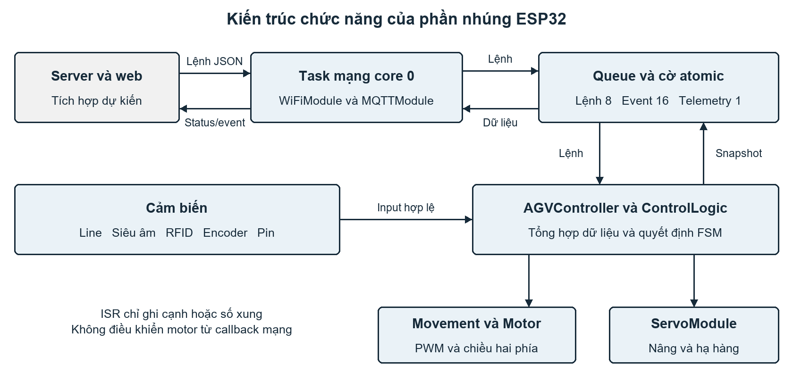
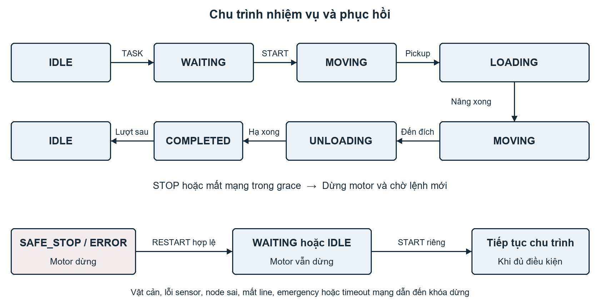

# Báo cáo phần nhúng của robot tự hành trong kho

Đề tài: Xây dựng hệ thống quản lý robot tự hành trong kho dựa trên nền tảng IoT.

Phạm vi chuyên môn: thiết kế và lập trình hệ thống nhúng ESP32 cho AGV. Thời điểm tổng hợp: ngày 29 tháng 9 năm 2026.

## Tóm tắt

Phần nhúng đảm nhiệm việc tiếp nhận nhiệm vụ từ hệ thống quản lý, đọc cảm biến, điều khiển chuyển động và cơ cấu nâng hạ, đồng thời gửi trạng thái robot qua mạng. Firmware hiện được tổ chức thành các module trên ESP32, sử dụng PlatformIO và Arduino. Robot bám vạch bằng ba cảm biến line, xác nhận các nút trên tuyến bằng RFID, đo quãng đường bằng hai encoder và kiểm tra vật cản bằng cảm biến siêu âm. Máy trạng thái quản lý chu trình nhận nhiệm vụ, di chuyển đến điểm lấy hàng, nâng hàng, giao hàng và hạ hàng.

Kết quả đã ghi nhận ở mức phần mềm gồm biên dịch firmware và 42 ca Unity native trên logic điều khiển, bộ phân tích lệnh. Chưa có bằng chứng thực nghiệm trên robot về độ chính xác quãng đường, độ trễ dừng, tải nâng hoặc độ tin cậy kết nối. Các tham số phần cứng và mạng còn cần cấu hình, hiệu chuẩn. Vì vậy, kết quả hiện tại chứng minh khả năng triển khai và kiểm tra logic phần nhúng, chưa đủ để kết luận hệ thống kho hoặc hai robot đã vận hành hoàn chỉnh.

## Mục lục

1. Chương 1 Nghiên cứu nguyên lý hoạt động robot tự hành trong kho bãi.
2. Chương 2 Nghiên cứu hệ thống quản lý robot tự hành trong kho bãi.
3. Chương 3 Tìm hiểu các giao thức sử dụng trong hệ thống robot tự hành.
4. Chương 4 Thiết kế và thi công robot tự hành.
5. Chương 5 Xây dựng trang web quản lý hệ thống robot tự hành.
6. Kết luận, tài liệu tham khảo và phụ lục kiểm chứng.

<!-- pagebreak -->

## Chương 1 Nghiên cứu nguyên lý hoạt động robot tự hành trong kho bãi

### 1.1 Vai trò của hệ thống nhúng

AGV là phương tiện tự hành thực hiện việc vận chuyển theo tuyến được xác định trong môi trường kho. Trong mô hình của đề tài, hệ thống quản lý quyết định nhiệm vụ và đường đi; ESP32 thực hiện các hành động tại robot. Cách phân công này giúp phần điều khiển tại xe tập trung vào cảm biến, chuyển động và các điều kiện dừng, trong khi bài toán bản đồ và phân phối nhiệm vụ nằm ở phía máy chủ.

Firmware hiện tại không chạy thuật toán A-Star. Đầu vào của nó là danh sách nút trong trường `path` do server cung cấp. Ba cảm biến line hỗ trợ bám đường giữa các nút; RFID xác nhận robot vừa đi đến nút nào; encoder cung cấp quãng đường đã di chuyển kể từ nút gần nhất. Dữ liệu siêu âm và trạng thái kết nối được dùng để quyết định có cho phép chuyển động hay không. Việc phân tách chức năng này thể hiện trực tiếp trong `AGVController`, `ControlLogic` và các module ngoại vi.

### 1.2 Cảm biến dò line và nguyên lý phản xạ hồng ngoại

Cảm biến phản xạ quang học sử dụng nguồn phát hồng ngoại và phần tử thu để nhận ánh sáng phản xạ từ mặt đường. Tín hiệu thu thay đổi theo vật liệu bề mặt, khoảng cách lắp và ánh sáng môi trường. TCRT5000 là một ví dụ linh kiện gồm bộ phát hồng ngoại và phototransistor [1]. Đây là cơ sở giải thích nguyên lý; loại cảm biến line cụ thể trên robot cần được xác nhận qua phần cứng thực tế.

Trong module dò line thông dụng, tín hiệu từ photodiode hoặc phototransistor có thể được đưa qua mạch so sánh, chẳng hạn LM393, để tạo tín hiệu Digital. LM393 có ngõ ra open-collector, nên mức HIGH phụ thuộc mạch kéo lên [2]. Biến trở trên module, nếu có, đặt ngưỡng so sánh. Ngõ Analog, nếu module cung cấp, phản ánh mức tín hiệu trước so sánh và có thể dùng để khảo sát độ tương phản của vạch với nền. Cấu trúc chính xác phải đối chiếu sơ đồ module, không suy ra chỉ từ tên cảm biến.

Trong firmware của đề tài, ba cảm biến trái, giữa, phải được đọc bằng `digitalRead`; chưa có thuật toán đọc Analog cho line. Các GPIO tương ứng là 39, 34 và 35. Giá trị raw được chuẩn hóa theo `LINE_SENSOR_ACTIVE_STATE` để bit 1 luôn có nghĩa là cảm biến đang thấy vạch. Cực tính chưa được xác nhận, nên cấu hình hiện giữ giá trị -1 và không cho phép vận hành với dữ liệu line chưa cấu hình.

| Mẫu trái giữa phải | Ý nghĩa sau chuẩn hóa | Hành động khi bám line thông thường |
| --- | --- | --- |
| 000 | Không cảm biến nào thấy vạch | Dừng và báo mất line |
| 001 | Vạch về phía phải | Giảm tốc phía phải để sửa phải |
| 010 | Vạch ở giữa | Tiến thẳng |
| 011 | Giữa và phải thấy vạch | Sửa phải |
| 100 | Vạch về phía trái | Giảm tốc phía trái để sửa trái |
| 101 | Hai bên thấy vạch, giữa không thấy | Dừng vì hướng không rõ |
| 110 | Trái và giữa thấy vạch | Sửa trái |
| 111 | Cả ba thấy vạch | Dừng vì hướng không rõ |

Bảng trên mô tả chế độ bám line thông thường. Khi server đã cung cấp hướng rời nút và thời gian đã hiệu chuẩn, firmware có pha riêng để rẽ trái, rẽ phải hoặc đi thẳng qua giao điểm. Robot không tự xem mọi mẫu 111 là một nút: việc xác nhận nút vẫn thuộc RFID.

GPIO34 đến GPIO39 của ESP32 chỉ hỗ trợ đầu vào và không có pull-up/pull-down nội [3]. Do đó, việc dùng các chân này phù hợp với đọc line nhưng cần xác nhận mức điện áp và điện trở ngoài theo module. Khi thử nghiệm, cần đo raw trên vạch và nền trước khi chọn cực tính, rồi kiểm tra chiều sửa lái với bánh kê khỏi mặt đất.

### 1.3 Cảm biến vật cản

Hai phương án thường gặp là cảm biến hồng ngoại và cảm biến siêu âm. Cảm biến hồng ngoại phản xạ phụ thuộc đặc tính quang học của vật; cảm biến siêu âm dựa trên thời gian truyền và phản xạ của sóng âm. Phương án đang được lập trình trong dự án là giao diện TRIG/ECHO của HC-SR04. Firmware chưa triển khai cảm biến hồng ngoại như một kênh vật cản bổ sung.

`SensorModule` phát xung TRIG và ghi thời điểm hai cạnh ECHO bằng ngắt. Khoảng cách trong code được tính bằng thời gian ECHO nhân với hệ số vận tốc âm thanh 0,0343 cm/us rồi chia hai, vì tín hiệu đi đến vật và quay trở lại. Hệ số này là giá trị đang dùng trong chương trình, chưa phải kết quả hiệu chuẩn theo nhiệt độ hoặc môi trường kho.

Chu kỳ kích đo được đặt 60 ms, xung TRIG 10 us, timeout ECHO 25.000 us. Kết quả quá 200 ms được xem là stale. Các số này là tham số phần mềm hiện tại, không phải thời gian phản ứng hay độ chính xác đã đo. Ngắt chỉ ghi thông tin cạnh; phép tính và quyết định điều khiển nằm ngoài ISR.

Khi khoảng cách hợp lệ nhỏ hơn hoặc bằng `OBSTACLE_DISTANCE_CM`, logic chuyển sang dừng an toàn. Khi không có ECHO, timeout hoặc dữ liệu quá cũ, khoảng cách trở thành giá trị không hợp lệ; robot không coi đó là đường trống. Telemetry biểu diễn trường không hợp lệ bằng JSON `null`. Ngưỡng vật cản còn giữ 0 để đánh dấu chưa hiệu chuẩn, nên chưa đủ điều kiện chạy robot.

Ngưỡng dừng phải được lựa chọn từ phép đo vận tốc, độ trễ phát hiện, quãng đường trôi sau lệnh dừng và khoảng dự phòng. Firmware hiện dừng khi gặp vật cản, chưa có chức năng tránh vật cản hay tự lập đường vòng. ECHO phải được chuyển mức phù hợp trước khi nối vào ESP32; việc cấu hình INPUT không tạo khả năng chịu điện áp 5 V.

### 1.4 Điều khiển động cơ DC bằng PWM

PWM thay đổi tỷ lệ thời gian bật của tín hiệu điều khiển trong một chu kỳ. Trong dự án, motor dùng tần số 5 kHz, độ phân giải 8 bit và giá trị duty từ 0 đến 255. Duty mặc định 150 tương đương khoảng 58,8 phần trăm thang điều khiển; đây không phải tốc độ 150 vòng/phút hay 58,8 phần trăm vận tốc tối đa đã đo.

Hai motor cùng phía trái nhận chung một lệnh; hai motor cùng phía phải nhận chung một lệnh. Tiến thẳng đặt hai phía cùng duty. Sửa trái giảm duty phía trái; sửa phải giảm duty phía phải. Quay tại chỗ điều khiển hai phía ngược chiều. `MotorModule` thực hiện ngõ ra điện, còn `MovementModule` diễn giải hành động chuyển động.

L298 là driver cầu H kép với ngõ điều khiển và enable [4]. Với phương án L298N trong code, ENA/ENB nhận PWM, các ngõ IN nhận tín hiệu chiều. Việc chọn module phải dựa trên dòng khởi động, tổng dòng hai motor mỗi phía và tản nhiệt của board thực tế; tên IC không đủ để kết luận driver phù hợp tải. Firmware còn có adapter BTS7960, nhưng cách đấu dây và cách phát PWM khác L298N. Cấu hình hiện là `Unconfigured`, chưa xác nhận driver được lắp.

Hàm `motorStop()` đưa PWM về 0 và các ngõ hướng hoặc enable về LOW theo adapter. Lệnh dừng này cần được thực thi ở driver, không thể thay thế bằng cập nhật trạng thái hoặc gửi MQTT. Hiệu quả phanh, trôi và quãng dừng vẫn phụ thuộc cơ khí, nguồn và driver thực tế.

### 1.5 Encoder và vấn đề đồng bộ hai phía

Mỗi encoder được đọc qua một ngắt RISING độc lập, sử dụng bộ đếm 64 bit. Quãng đường được tính từ số xung chia cho số xung trên một vòng bánh, rồi nhân chu vi bánh. `ENCODER_PPR` phải biểu diễn số cạnh RISING trên một vòng bánh; nếu encoder nằm ở trục motor thì cần quy đổi tỷ số truyền. Đường kính bánh cần đo trong điều kiện có tải.

Hai bộ đếm được chụp trong cùng vùng bảo vệ để tránh dữ liệu không nhất quán khi ngắt xảy ra. Khi robot nhận một node RFID mới đã ánh xạ, controller chụp và reset cả hai bộ đếm bằng `snapshotAndReset()`. Sự kiện gửi lên server giữ quãng đường của đoạn vừa hoàn tất; telemetry sau đó bắt đầu đo từ node mới. Đọc lặp cùng node không reset liên tục.

Firmware hiện gửi số xung và khoảng cách trái/phải, nhưng chưa dùng sai lệch encoder để đóng vòng điều khiển tốc độ. Đặt cùng PWM không bảo đảm hai phía có cùng vận tốc vì motor, tải và ma sát có thể khác nhau. Hướng phát triển là đo vận tốc theo cửa sổ thời gian và bổ sung PI/PID sau khi có số liệu, giới hạn duty và cơ chế chống tích lũy sai lệch phù hợp. Đây là đề xuất nghiên cứu, chưa phải chức năng hiện có.

Encoder một kênh chỉ ghi số cạnh, không xác định chiều quay như encoder quadrature. Khoảng cách trung bình hai phía là ước lượng hành trình, không phải tọa độ tuyệt đối trên bản đồ. Sai số trượt bánh và sai số đường kính phải được đánh giá bằng quãng đường chuẩn.

<!-- pagebreak -->

## Chương 2 Nghiên cứu hệ thống quản lý robot tự hành trong kho bãi

### 2.1 Luồng hoạt động từ nhiệm vụ đến điều khiển motor

Luồng điều khiển gồm tiếp nhận lệnh, kiểm tra dữ liệu, đưa lệnh vào hàng đợi, kiểm tra điều kiện vận hành, cập nhật máy trạng thái và áp dụng hành động xuống driver. `CommandCodec` chịu trách nhiệm phân tích JSON. `MQTTModule` chuyển dữ liệu giữa mạng và controller. `ControlLogic` quyết định hành động theo trạng thái; `AGVController` liên kết quyết định đó với cảm biến và cơ cấu chấp hành.



Hình 1 Sơ đồ chức năng của phần nhúng. Khối server và web thể hiện phạm vi tích hợp dự kiến, chưa có mã triển khai trong workspace.

Nhận `TASK` chỉ lưu nhiệm vụ và đưa robot vào `WAITING`; chưa làm motor chạy. `START` là lệnh riêng. Robot cần có cấu hình motion và servo hợp lệ, mạng hoạt động, siêu âm hợp lệ, không có vật cản và RFID hiện tại khớp node route đang chờ. Node đầu path là vị trí xuất phát; `startNode` trong nhiệm vụ mang nghĩa điểm lấy hàng, có thể nằm giữa path.

Khi đến điểm lấy hàng, motor dừng trước khi servo nâng hàng. Firmware chờ thời gian settling đã cấu hình rồi mới cho chuyển động tiếp. Đến node đích cuối path, motor dừng, servo hạ hàng, chờ settling và phát sự kiện hoàn thành. Firmware dùng thời gian để suy ra pha servo kết thúc; chưa có công tắc hành trình hoặc phản hồi xác nhận hàng đã nâng/hạ thực tế.

### 2.2 Xử lý dữ liệu từ nhiều cảm biến

Các cảm biến đóng góp thông tin khác nhau và không thay thế lẫn nhau. Line phản ánh vị trí tương đối với vạch; RFID xác nhận node; encoder đo hành trình giữa các node; siêu âm cung cấp điều kiện vật cản; ADC hỗ trợ theo dõi điện áp pin. Controller tổng hợp chúng thành `ControlInput` và `TelemetrySnapshot` với kiểu dữ liệu, đơn vị và trạng thái hợp lệ rõ ràng.

Trong mỗi lượt cập nhật, controller xử lý siêu âm, servo, cờ dừng ưu tiên và kiểm tra an toàn trước khi đọc RFID. Sau thao tác RFID, controller cập nhật siêu âm và kiểm tra an toàn tiếp để tránh dùng dữ liệu cũ xuyên qua một thao tác ngoại vi. Lệnh từ mạng được tiêu thụ với số lượng giới hạn theo kích thước queue. Cuối lượt, hành động motor và servo được áp dụng, pin được lấy mẫu và telemetry được cập nhật.

Cách tổ chức này giảm sự phụ thuộc vào mạng trong luồng điều khiển. Tuy nhiên, thời gian SPI của RFID, Serial, ADC và bộ lập lịch vẫn cần đo. Không thể suy ra một deadline vòng lặp hay độ trễ dừng vật lý chỉ từ việc code không có vòng chờ mạng trong `loop()`.

### 2.3 Máy trạng thái của AGV

Các trạng thái khái quát Idle, Running, Obstacle và Error có thể dùng để giải thích nguyên lý. Firmware hiện triển khai tám trạng thái chi tiết hơn. Running tương ứng chủ yếu với `MOVING`; vật cản được lưu thành mã lỗi `OBSTACLE` trong `SAFE_STOP`, không có enum `AGV_OBSTACLE` riêng.

| Trạng thái | Vai trò | Hành động motor |
| --- | --- | --- |
| IDLE | Chờ nhiệm vụ mới | Dừng |
| WAITING | Có nhiệm vụ nhưng đang chờ START hoặc bị tạm dừng | Dừng |
| MOVING | Bám line hoặc thực hiện hướng rời node | Theo quyết định điều khiển |
| LOADING | Nâng hàng tại điểm lấy hàng | Dừng |
| UNLOADING | Hạ hàng tại điểm giao | Dừng |
| COMPLETED | Ghi nhận hoàn thành nhiệm vụ | Dừng |
| SAFE_STOP | Khóa chuyển động do điều kiện dừng an toàn | Dừng |
| ERROR | Lỗi khiến chu trình không thể tiếp tục | Dừng |



Hình 2 Chu trình nhiệm vụ điển hình và đường phục hồi. Nếu điểm lấy hàng là node đầu, START có thể chuyển trực tiếp sang LOADING.

`SAFE_STOP` giữ trạng thái dừng cho đến khi có thao tác phục hồi hợp lệ. Loại bỏ vật cản hoặc kết nối mạng trở lại không tự làm xe chạy. `RESTART` kiểm tra điều kiện hiện tại rồi đưa về `WAITING` hoặc `IDLE`; `START` tiếp tục là thao tác riêng. `CANCEL_TASK` xóa nhiệm vụ và dừng motor nhưng không tự xóa lỗi an toàn.

Nếu robot bị dừng giữa pha quay, vị trí RFID gần nhất không đủ để biết heading còn lại. Firmware đánh dấu pha quay bị gián đoạn và yêu cầu hủy nhiệm vụ, định vị lại, phục hồi rồi nhận route mới. Nhãn O1 đến O10 không mã hóa hướng địa lý và không thay thế bản đồ.

### 2.4 Phân công giữa robot và hệ thống quản lý

Server cần lưu bản đồ, tính path, chọn hướng rời từng node và điều phối tài nguyên dùng chung giữa các xe. ESP32 thực hiện route đã nhận, kiểm tra node theo thứ tự và báo sự kiện. Nếu gặp UID chưa ánh xạ khi đang di chuyển, vị trí bị vô hiệu và robot dừng; gặp node ngoài thứ tự route cũng gây dừng.

Điều phối hai robot cần thêm cơ chế đặt chỗ đường hoặc vùng giao cắt, xử lý xung đột nhiệm vụ và theo dõi dữ liệu quá cũ. Có hai AGV ID và hai bộ topic riêng chỉ là điều kiện định danh; chưa chứng minh tránh va chạm hay điều phối đội xe. Workspace hiện có firmware và tài liệu hợp đồng giao tiếp, chưa có backend hoặc thuật toán điều phối hai robot.

<!-- pagebreak -->

## Chương 3 Tìm hiểu các giao thức sử dụng trong hệ thống robot tự hành

### 3.1 Wi-Fi trên ESP32 và xử lý mất kết nối

`WiFiModule` cấu hình ESP32 ở chế độ station và yêu cầu kết nối đến SSID đã khai báo. Mỗi lần kết nối lại cách nhau 5.000 ms theo cấu hình phần mềm. Module không dùng vòng `while` đợi Wi-Fi trong luồng điều khiển chính. SSID và mật khẩu hiện còn rỗng; chưa có kết quả kết nối đến mạng thực tế được ghi nhận trong báo cáo QA.

Wi-Fi hoạt động không đồng nghĩa MQTT hoạt động. Controller theo dõi riêng sức khỏe Wi-Fi và MQTT. Khi phát hiện mất một kết nối, motor dừng và nhiệm vụ chờ trong khoảng grace nếu được cấu hình. Khi vượt timeout, robot vào `SAFE_STOP`; timeout bằng 0 khóa ngay khi phát hiện mất kết nối. Kết nối lại không tự khởi động nhiệm vụ.

Thời điểm phát hiện broker mất còn phụ thuộc TCP, keepalive và lịch chạy task. Vì vậy, timeout trong Config không thể được xem là toàn bộ thời gian từ mất mạng vật lý đến xe dừng. Phép thử ngắt access point, dừng broker và mất gói phải được thực hiện riêng.

### 3.2 Mô hình MQTT và mức chất lượng dịch vụ

MQTT dùng mô hình publish/subscribe: client gửi thông điệp đến broker theo topic, broker chuyển thông điệp cho các client đã subscribe. QoS 0, 1 và 2 trong chuẩn MQTT lần lượt mô tả mức giao tối đa một lần, ít nhất một lần và đúng một lần ở tầng giao thức [5]. Những mức này không xác nhận motor đã chạy hoặc nhiệm vụ kho đã hoàn thành.

Dự án dùng PubSubClient 2.8, publish và subscribe QoS 0, thông điệp không retained. API publish của phiên bản này không cung cấp publish QoS 1/2 [6]. Vì vậy, một lần publish trả về thành công chưa bảo đảm server đã lưu dữ liệu. Firmware sử dụng `AGV_COMMAND_RESULT` để phản hồi việc controller chấp nhận lệnh và `AGV_TASK_COMPLETED` để thông báo kết thúc nhiệm vụ, nhưng cơ chế này chưa có xác nhận lưu sự kiện bền vững từ server.

| Nhóm topic cấu hình | Chiều truyền | Dữ liệu chính |
| --- | --- | --- |
| COMMAND | Server đến robot | TASK, START, STOP và các lệnh vận hành |
| STATUS | Robot đến server | State, error, task, motor, sensor và kết nối |
| POSITION | Robot đến server | Node RFID và khoảng cách kể từ node đó |
| DISTANCE | Robot đến server | Xung và khoảng cách encoder hai phía |
| EVENT | Robot đến server | Node mới, kết quả lệnh và hoàn thành task |
| ERROR | Robot đến server | Mã lỗi và thông điệp mất kết nối LWT |

Sáu topic phải khác nhau, là topic cụ thể, không chứa wildcard và dài tối đa 128 ký tự theo kiểm tra của firmware. Tên cuối cùng còn cần thống nhất với server. Mỗi robot phải có ID và bộ topic riêng.

### 3.3 Lập trình MQTT và kiểm tra JSON

Lệnh dùng envelope gồm `version`, `id`, `session`, `command`. Với TASK, dữ liệu bổ sung có `task.id`, `startNode`, `targetNode` và `path`. Parser giới hạn payload 1.024 byte, route tối đa 32 node, node thuộc O1 đến O10, điểm lấy hàng nằm trong path và target là node cuối. Kiểu dữ liệu sai, lệnh lạ, JSON dư dữ liệu hoặc chuỗi chứa NUL đều bị từ chối theo kiểm tra hiện có.

Ví dụ sau minh họa cấu trúc lệnh, không phải route đã chạy hoặc session thật. Các UID của route phải được cấu hình trước khi controller chấp nhận TASK.

```json
{
  "version": 1,
  "id": "cmd-001",
  "session": 123,
  "command": "TASK",
  "task": {
    "id": "task-001",
    "startNode": "O3",
    "targetNode": "O10",
    "path": ["O1", "O3", "O5", "O8", "O10"]
  }
}
```

Trong ví dụ, robot xuất phát ở O1, lấy hàng ở O3 và giao ở O10. Server phải đọc session hiện hành từ status/event rồi thay giá trị 123, chờ kết quả TASK và gửi START bằng một command ID mới. Hướng rời node có thể dùng step object với `departure` là FOLLOW, LEFT, RIGHT hoặc STRAIGHT; tính phù hợp của hướng với bản đồ thuộc trách nhiệm server.

Mỗi kết nối MQTT thành công tạo một session nonce mới. Lệnh thường sai session hoặc nằm trong queue quá 2.000 ms bị từ chối. Cửa sổ 16 ID gần nhất giúp tránh thực hiện lặp lại lệnh đã nhận; đây là giới hạn bộ nhớ hiện có, không phải cơ chế chống replay vĩnh viễn. STOP và EMERGENCY_STOP được đặt cờ ưu tiên ngay sau khi payload vượt qua kiểm tra schema, không phụ thuộc sức chứa queue hoặc session hiện hành.

Event, ACK và error dùng FIFO RAM 16 bản ghi. Telemetry giữ một snapshot mới nhất để tránh tích lũy trạng thái cũ. Nếu publish event thất bại, bản ghi đầu được giữ lại để thử tiếp. Queue overflow gây dừng an toàn. FIFO mất khi reset; QoS 0 vẫn có thể mất thông điệp sau khi ghi socket thành công. Muốn bảo đảm lịch sử phải bổ sung event ID, ACK phía ứng dụng và cơ chế lưu bền theo yêu cầu tích hợp tiếp theo.

### 3.4 Giao tiếp nội bộ

| Giao tiếp | Cách dùng hiện tại | Giới hạn cần chú ý |
| --- | --- | --- |
| GPIO Digital | Line, chiều motor, TRIG/ECHO, encoder | Mức điện áp, cực tính và ngắt |
| PWM LEDC | Motor 5 kHz, servo 50 Hz | Phân vùng channel/timer, đo đồng thời |
| ADC | Đọc B25/chia áp tại GPIO36 | Hiệu chuẩn toàn mạch và dải điện áp |
| UART | Serial 115.200 baud để log qua kết nối máy tính | Chưa có giao thức UART giữa các controller |
| SPI | ESP32 giao tiếp MFRC522 | Nguồn, dây, UID và thời gian đọc |
| I2C | Chưa dùng trong firmware hiện tại | Là nội dung nghiên cứu, chưa có ngoại vi I2C active |

MFRC522 hỗ trợ giao tiếp với bộ xử lý chủ và chức năng đọc thẻ; dự án sử dụng SPI [7]. `RFIDModule` gọi `SPI.begin` với SCK 18, MISO 19, MOSI 23 và SS 5. UART hiện phục vụ nạp/debug và log ứng dụng; không nên mô tả rằng robot đang dùng UART hoặc I2C để kết nối những module chưa có trong source.

### 3.5 Dữ liệu pin và giới hạn bảo mật

`BatteryModule` lấy mẫu ADC mỗi 500 ms, sử dụng điện áp ADC millivolt rồi áp dụng hệ số scale và offset của toàn mạch để ước lượng điện áp pin. Sau đó điện áp được nội suy giữa mốc empty và full để ước lượng phần trăm. Chưa có hệ số hoặc mốc hiệu chuẩn, nên trường điện áp pin và phần trăm là `null`. Phần trăm tuyến tính không phải phép đo state of charge chính xác; firmware chưa có chính sách tự dừng do pin thấp.

Transport MQTT hiện dùng `WiFiClient` plaintext, chưa có TLS. Username/password broker là tùy chọn cấu hình; session dùng để phân biệt lượt kết nối, không phải cơ chế xác thực. Hệ thống thử cần mạng được kiểm soát và ACL broker phù hợp. Lệnh emergency qua MQTT có độ trễ và phụ thuộc mạng, nên mạch dừng cứng phải được thiết kế, kiểm tra riêng cùng phần nguồn và driver.

<!-- pagebreak -->

## Chương 4 Thiết kế và thi công robot tự hành

### 4.1 Thiết kế phần cứng và bảng chân

Bảng chân hiện hành được lấy từ `Config.h`, theo đặc tả firmware ngày 28 tháng 9 năm 2026. Đây là thiết kế kết nối của bản firmware active; chưa phải biên bản xác nhận dây trên robot. Firmware gốc được lưu riêng trong archive để giữ lịch sử kỹ thuật.

| Khối | Tín hiệu | GPIO |
| --- | --- | --- |
| Motor trái | ENA, IN1, IN2 | 14, 27, 26 |
| Motor phải | ENB, IN3, IN4 | 25, 33, 32 |
| Line | Trái, giữa, phải | 39, 34, 35 |
| Siêu âm | TRIG, ECHO | 12, 13 |
| Pin | B25/chia áp ADC1 | 36 |
| RFID SPI | SCK, MISO, MOSI | 18, 19, 23 |
| RFID điều khiển | SS, RST | 5, 22 |
| Encoder | Trái, phải | 4, 16 |
| Servo | Servo 1, 2, 3 | 15, 17, 21 |

`static_assert` kiểm tra 22 GPIO không trùng nhau. GPIO5, 12 và 15 là chân strapping của ESP32; ngoại vi không được ép sai mức khi reset. GPIO16/17 phải đối chiếu module vật lý và khả năng sử dụng chân với flash/PSRAM [3]. Firmware hướng đến môi trường `esp32dev`; tên môi trường không thay thế việc xác nhận đúng board DevKit và sơ đồ chân ngoài thực tế.

Phần nguồn cần đáp ứng dòng motor và servo dưới tải, có bảo vệ và mass phù hợp. RC522, cảm biến, ADC và ESP32 cần mức điện áp tương thích. Motor và servo không được cấp tải trực tiếp từ GPIO. Sơ đồ nguồn, BOM và ảnh đấu dây hiện chưa có bằng chứng nghiệm thu, nên cần bổ sung trước thử vận hành.

### 4.2 Kiến trúc phần mềm theo module

`main.cpp` chỉ khởi tạo Serial, gọi `agv.begin()` và lặp `agv.update()`. Phần còn lại được chia theo trách nhiệm để có thể kiểm tra độc lập và hạn chế sự phụ thuộc giữa mạng, cảm biến và driver.

| Module | Trách nhiệm chính |
| --- | --- |
| AGVController | Tổng hợp input, xử lý lệnh, áp dụng output, tạo telemetry |
| ControlLogic | FSM nhiệm vụ, kiểm tra điều kiện và phục hồi |
| CommandCodec | Parse và kiểm tra envelope JSON |
| MotorModule | Phát PWM, chiều và dừng driver |
| LineFollowModule | Đọc line và thao tác sửa lái |
| MovementModule | Áp dụng hành động tiến, lùi, rẽ, dừng |
| SensorModule | Đo siêu âm, timeout và stale |
| EncoderModule | Đếm ngắt, snapshot và reset hai phía |
| RFIDModule | Đọc UID, ánh xạ node và nhận diện node mới |
| ServoModule | Phát xung và quản lý pha nâng/hạ |
| BatteryModule | Đọc ADC, chuyển đổi điện áp và phần trăm |
| WiFiModule | Yêu cầu kết nối và retry Wi-Fi |
| MQTTModule | Task mạng, command queue, event FIFO và telemetry |

`ControlLogic` và `CommandCodec` không phụ thuộc Arduino/GPIO, nên native Unity gọi trực tiếp hai module production này. RFID, encoder và callback MQTT không tự điều khiển motor. Quyết định chuyển động được tập trung ở controller và logic điều khiển để có thể theo dõi nguyên nhân dừng.

### 4.3 FreeRTOS và đồng bộ tài nguyên

Firmware sử dụng FreeRTOS của Arduino ESP32. Task `agv-network` được ghim core 0, priority 1, stack khai báo 12.288 byte. Task này sở hữu quá trình kết nối Wi-Fi, PubSubClient, nhận JSON và gửi dữ liệu. Luồng Arduino `loop()` chạy controller; không có thiết kế mỗi cảm biến một task riêng.

Command queue dài 8 bản ghi truyền lệnh từ task mạng sang controller. Event FIFO dài 16 bản ghi truyền phản hồi/sự kiện ra mạng. Telemetry queue có một phần tử và được ghi đè bằng snapshot mới nhất. Cờ atomic dành cho STOP, EMERGENCY_STOP và lỗi queue giúp controller nhận yêu cầu dừng ngay cả khi queue thường không thể chứa thêm lệnh.

Hai encoder và ECHO sử dụng critical section để đồng bộ ISR với luồng đọc. ISR không gọi MQTT, tạo JSON hoặc cấp phát bộ nhớ. Thời gian ngắt, tải CPU, stack high-water mark và hành vi đồng thời vẫn cần đo trên board. Worker heartbeat quá 2.000 ms khiến MQTT health false; cơ chế này không chứng nhận một deadline dừng trên phần cứng.

### 4.4 PWM motor và servo

Motor dùng LEDC channel 0 đến 3; servo dùng 4, 5 và 6. Theo ánh xạ của Arduino ESP32 2.0.17, hai nhóm được phân vào timer khác nhau [8]. Motor sử dụng 5 kHz/8 bit, servo dùng 50 Hz/16 bit. Việc tách này tránh cấu hình servo 50 Hz làm thay đổi timer motor trong thiết kế hiện tại, nhưng vẫn phải kiểm tra dạng sóng khi cả hai hoạt động.

Ba chân servo đã được khai báo nhưng mặc định đều disabled, vai trò SCAN/LIFT/OTHER chưa gán. Firmware chỉ phát lệnh hoạt động cho servo vai trò LIFT. Góc nâng, góc hạ, độ rộng xung giới hạn và thời gian settling chưa được điền. Khi boot, firmware không tự đặt góc servo. Khi SAFE_STOP, motor dừng nhưng servo giữ mục tiêu xung đã gửi; chương trình không cắt nguồn servo hoặc đảo cơ cấu giữa tải.

### 4.5 Môi trường phát triển và nạp firmware

Môi trường hiện pin PlatformIO espressif32 6.13.0, board `esp32dev`, framework Arduino và C++17. Báo cáo QA đã ghi core Arduino 2.0.17. Các thư viện khai báo gồm MFRC522 1.4.12, PubSubClient 2.8 và ArduinoJson 6.21.5. Servo sử dụng native LEDC; không sử dụng ESP32Servo trong bản modular active.

Quy trình chuẩn bị bắt đầu bằng đối chiếu GPIO, điện áp, nguồn và cấu hình phần cứng, rồi chạy Validate, Test, Build. Nếu thay source firmware, cần xuất lại tài liệu code bằng ExportFirmware. Nạp là bước riêng, sau khi xác định cổng nối đúng board và chuẩn bị nguồn/ngắt tải phù hợp.

```powershell
pio device list
pio run --project-dir NCKHAGV -e esp32dev -t upload --upload-port COM_PORT
pio device monitor --port COM_PORT --baud 115200
```

`COM_PORT` trong ví dụ là placeholder cần thay bằng cổng đã xác nhận. Các lệnh trên là hướng dẫn, chưa được thực hiện trong lần viết báo cáo. Sau nạp, cần kiểm tra boot, log cấu hình, motor ở trạng thái dừng, RFID node, sensor validity và session MQTT trước khi gửi TASK/START. Cập nhật hiện tại thực hiện bằng build rồi nạp lại; chưa có cơ chế OTA trong firmware.

### 4.6 Kết quả phần mềm đã ghi nhận

Nguồn kết quả là báo cáo QA firmware modular ngày 28 tháng 9 năm 2026 [9]. Các giá trị dưới đây thuộc lần kiểm thử đã ghi trong nguồn đó, không phải phép đo mới hoặc kết quả thực nghiệm trên xe ngày 29 tháng 9.

| Hạng mục | Kết quả đã ghi | Phạm vi chứng minh |
| --- | --- | --- |
| Biên dịch esp32dev | PASS | Compiler và liên kết firmware |
| Native Unity | PASS 42 trên 42 | ControlLogic và CommandCodec production |
| Workspace Validate | PASS | Liên kết, skill, ánh xạ yêu cầu và ranh giới module |
| RAM tĩnh sau build | 48.600 trên 327.680 byte, 14,8 phần trăm | Thông tin linker, không phải toàn bộ RAM runtime |
| Flash sau build | 788.957 trên 1.310.720 byte, 60,2 phần trăm | Kích thước firmware của lần build đã ghi |

Native test bao phủ bảng chân, chuẩn hóa line, phép tính và cấu hình chưa biết, path, chu trình lấy/giao, node bất thường, mất mạng, timeout, khóa dừng, phục hồi, giao điểm và giới hạn parser. Các test không bao phủ trực tiếp ISR GPIO, sóng PWM, driver motor, cơ khí nâng hay đường truyền broker thật.

TC-002 đến TC-020 ở phần hardware/hệ thống và TC-025/TC-026 chưa có thực thi được ghi nhận. TC-021 đến TC-024 chỉ có bằng chứng cho phần source/native tương ứng, chưa nghiệm thu toàn ca trên xe. `Config.h` còn sentinel cho driver, cực tính line, ngưỡng vật cản, encoder, UID, servo, pin và mạng. Firmware build được với các sentinel này nhưng chưa sẵn sàng chạy nhiệm vụ trên robot.

### 4.7 Kế hoạch thử nghiệm phần nhúng

| Nhóm thử và mã ca | Dữ liệu cần ghi | Trạng thái thực nghiệm |
| --- | --- | --- |
| Boot, PWM, motor và servo TC-002, 012, 013 | Mức ngõ ra khi reset, duty/tần số, chiều quay, dòng tải, hành trình | NOT_RUN |
| Line TC-003, 005 | Raw của tám tổ hợp, cực tính, sửa lái, mất line | NOT_RUN |
| Siêu âm TC-004, 006 | Khoảng cách chuẩn, timeout, latency, quãng dừng với tải | NOT_RUN |
| RFID và encoder TC-007, 008, 014, 025 | UID, tỷ lệ đọc, số xung, reset đồng thời, sai số hành trình | NOT_RUN |
| Mạng và lệnh TC-009, 010, 011, 026 | Ngắt Wi-Fi/broker, session, ACK, queue overflow, phục hồi | NOT_RUN trên board và broker |
| Chu trình lấy và giao TC-022, 024 | Thứ tự node, settling, rẽ và xử lý dừng giữa pha | NOT_RUN trên robot |
| Pin TC-018 | ADC, điện áp đồng hồ, scale/offset, điện áp dưới tải | NOT_RUN |

Mỗi phép thử phải ghi board, firmware hoặc hash, sơ đồ đấu nối, driver, pin, tải, mặt đường, cấu hình, dụng cụ và số lần lặp. Với latency dừng cần đo từ một mốc sự kiện rõ ràng đến thay đổi PWM, rồi đo thêm quãng đường vật lý đến đứng yên. Với encoder cần lưu dữ liệu xung và quãng đường chuẩn. Với mạng cần thử cả tình huống không có kết nối ngay khi boot và mất kết nối trong từng pha nhiệm vụ.

Ngưỡng sai số, tải nâng, quãng dừng, tỷ lệ đọc RFID và ngân sách vòng điều khiển chưa được chốt. Kết quả đo sau này có thể dùng xây baseline; chỉ kết luận PASS nghiệm thu khi tiêu chí có đơn vị, điều kiện và ngưỡng cụ thể. Không chuyển ca dự kiến thành PASS chỉ vì biên dịch hoặc unit test thành công.

<!-- pagebreak -->

## Chương 5 Xây dựng trang web quản lý hệ thống robot tự hành

### 5.1 Phạm vi đóng góp của phần nhúng

Trang web dự kiến quản lý robot, bản đồ kho, lộ trình, pin và lỗi. Trong phần nhúng, đóng góp trực tiếp là cung cấp dữ liệu và hợp đồng lệnh để backend/web sử dụng. Chương này mô tả điểm tích hợp của firmware; workspace hiện chưa có mã trang web, backend, A-Star server hoặc chạy thử hệ thống hai xe.

Mỗi telemetry mang `agvId`, `session`, `uptimeMs` cùng trạng thái robot, mã lỗi và thông tin nhiệm vụ. `uptimeMs` là thời gian từ lúc ESP32 boot, có wrap-around, không phải thời gian UTC. Backend cần gắn timestamp tiếp nhận riêng để đánh giá dữ liệu mới hay cũ. Giá trị cảm biến chưa hợp lệ hoặc chưa hiệu chuẩn phải được hiển thị là chưa xác định, không đổi `null` thành 0 phần trăm pin hoặc khoảng cách 0 cm.

### 5.2 Hiển thị bản đồ và lộ trình

RFID cung cấp node đã nhận gần nhất; encoder cung cấp hành trình từ node đó. Hai trường này có thể hỗ trợ biểu diễn tiến độ trên cạnh của bản đồ sau khi backend biết chiều và chiều dài tuyến. Chúng chưa tạo tọa độ x/y hay heading độc lập. Web không nên coi quãng đường trung bình encoder là vị trí tuyệt đối nếu chưa có mô hình bản đồ và xử lý sai số.

Server gửi path và hướng rời node dựa trên bản đồ. Firmware xác nhận thứ tự node khi chạy; nếu route sai hoặc UID không biết, robot dừng và báo lỗi. Khi một vùng đường được chia sẻ giữa hai xe, quyết định cho phép xe nào đi qua phải được quản lý ở server theo quy tắc điều phối được kiểm thử.

### 5.3 Quản lý nhiệm vụ, pin và lỗi

Luồng giao diện cần phân biệt gửi lệnh, lệnh được chấp nhận, robot đang thực hiện và nhiệm vụ hoàn thành. `AGV_COMMAND_RESULT` chứa command ID, accepted và error; `accepted=true` chỉ cho biết controller chấp nhận thao tác. Kết quả hoàn thành cần căn cứ `AGV_TASK_COMPLETED` cùng status/progress. Nếu không thấy phản hồi, giao diện cần phản ánh trạng thái chưa xác nhận thay vì suy ra xe đã chạy.

Thông tin pin gồm điện áp ADC, điện áp pin sau hiệu chuẩn và phần trăm ước lượng. Backend/web có thể lưu lịch sử để phục vụ nghiên cứu, nhưng chưa có chính sách sạc tự động hay cảnh báo pin thấp được nghiệm thu trong firmware. Các lỗi line, sensor, RFID, mạng và queue có thể hiển thị theo mã lỗi, trạng thái dừng và thời điểm server nhận dữ liệu.

### 5.4 Công việc tích hợp cần hoàn thiện

Để hình thành hệ thống quản lý đầy đủ, cần thống nhất topic và schema giữa robot với server, cấu hình AGV ID cho từng xe, xây backend lưu task/event, bổ sung bản đồ và thuật toán path, rồi xây giao diện hiển thị dữ liệu theo độ mới. Sau đó thử lệnh sai, mất mạng, sự kiện bị mất và hai xe tranh chấp đường. Các phần này là công việc tiếp theo của hệ thống tổng thể, không phải kết quả đã có từ firmware hiện tại.

## Kết luận

Phần nhúng đã triển khai kiến trúc module ESP32, đọc line/RFID/encoder/siêu âm, điều khiển motor và servo, đo pin qua ADC, giao tiếp MQTT và máy trạng thái thực hiện nhiệm vụ. Việc tách logic production khỏi phần GPIO tạo điều kiện kiểm thử native, đồng thời task mạng riêng và hàng đợi giúp phân tách xử lý kết nối với điều khiển tại xe.

Bằng chứng hiện có hỗ trợ kết luận firmware biên dịch được và 42 ca logic native đã PASS trong đợt QA ngày 28 tháng 9 năm 2026. Chưa đủ bằng chứng để kết luận robot chạy ổn định dưới tải, đạt độ chính xác định vị hoặc đáp ứng thời gian dừng cụ thể. Hướng ưu tiên là xác nhận phần cứng và cấu hình, hiệu chuẩn từng cảm biến/cơ cấu, thực hiện ca thử trên board và robot, sau đó tích hợp backend/web và kiểm tra điều phối hai xe.

## Tài liệu tham khảo

Các nguồn kỹ thuật bên ngoài được đối chiếu ngày 29 tháng 9 năm 2026. Datasheet linh kiện giải thích nguyên lý, không xác nhận BOM thực tế. Mã nguồn thư viện được tham chiếu theo phiên bản để phù hợp với firmware.

1. Vishay. [TCRT5000 TCRT5000L Reflective Optical Sensor with Transistor Output](https://www.vishay.com/docs/83760/tcrt5000.pdf). Nguồn nguyên lý cảm biến phản xạ và phototransistor.
2. Texas Instruments. [LM393 Dual Comparator](https://www.ti.com/product/LM393). Nguồn đặc tính bộ so sánh và open-collector.
3. Espressif. [ESP32 GPIO and RTC GPIO](https://docs.espressif.com/projects/esp-idf/en/stable/esp32/api-reference/peripherals/gpio.html). Nguồn giới hạn chân input-only, pull và strapping; không dùng API IDF mới để thay API Arduino đang pin.
4. STMicroelectronics. [L298 Dual Full Bridge Driver](https://www.st.com/en/motor-drivers/l298.html). Nguồn nguyên lý driver cầu H và enable.
5. OASIS. [MQTT Version 3.1.1](https://docs.oasis-open.org/mqtt/mqtt/v3.1.1/os/mqtt-v3.1.1-os.html). Nguồn publish/subscribe và ý nghĩa QoS.
6. Nick O'Leary. [PubSubClient source v2.8](https://github.com/knolleary/pubsubclient/blob/v2.8/src/PubSubClient.cpp). Nguồn API MQTT dùng trong firmware.
7. NXP. [MFRC522 Standard performance MIFARE and NTAG frontend](https://www.nxp.com/docs/en/data-sheet/MFRC522.pdf). Nguồn chức năng IC và giao tiếp với host.
8. Espressif. [Arduino ESP32 LEDC implementation 2.0.17](https://github.com/espressif/arduino-esp32/blob/2.0.17/cores/esp32/esp32-hal-ledc.c). Nguồn ánh xạ PWM channel/timer của phiên bản đang dùng.
9. Dự án AGV IoT. [QA firmware modular ngày 28 tháng 9 năm 2026](../qa/reports/2026-09-28-modular-firmware.md). Nguồn kết quả build, native test và giới hạn hardware.
10. Dự án AGV IoT. [Bối cảnh và hiện trạng](01-project-context.md), [kiến trúc](02-architecture.md), [phần cứng](03-hardware.md), [hợp đồng MQTT](04-mqtt-contract.md), [checklist cấu hình](06-configuration.md), [bàn giao source](firmware-delivery.md) và [đặc tả firmware](requirements/2026-09-28-agv-firmware-request.txt). Nguồn phạm vi và triển khai.

## Phụ lục A Đối chiếu nội dung báo cáo với source

| Nội dung | Source production cần đối chiếu |
| --- | --- |
| GPIO và tham số chưa hiệu chuẩn | Config.h |
| Kiểu trạng thái, lệnh và telemetry | Types.h |
| Chu trình, safety, route và phục hồi | ControlLogic.cpp, AGVController.cpp |
| Đọc line và hành động sửa lái | LineFollowModule.cpp, MovementModule.cpp |
| PWM, adapter và dừng motor | MotorModule.cpp |
| ECHO, timeout và stale | SensorModule.cpp |
| Ngắt, snapshot và reset encoder | EncoderModule.cpp |
| UID và ánh xạ node | RFIDModule.cpp |
| Servo và ADC pin | ServoModule.cpp, BatteryModule.cpp |
| Mạng, queue, session, JSON và publish | WiFiModule.cpp, MQTTModule.cpp, CommandCodec.cpp |

Các file trên nằm trong [NCKHAGV/src](../NCKHAGV/src). Cấu hình build nằm trong [platformio.ini](../NCKHAGV/platformio.ini); native test nằm trong [test_control](../NCKHAGV/test/test_control/test_main.cpp). Kế hoạch và tiêu chí thử nghiệm duy trì tại [test plan](../qa/test-plan.md) và [test cases](../qa/test-cases.md).

## Phụ lục B Thông tin cần bổ sung sau thực nghiệm

Khi có bàn thử, bổ sung BOM thực tế, sơ đồ nguồn/đấu dây, ảnh robot và đồ gá, UID từng node, dữ liệu hiệu chuẩn line/encoder/siêu âm/pin, góc và settling servo, log mạng cùng dữ liệu đo dừng. Mỗi kết quả cần kèm điều kiện và số lần lặp, xác định tiêu chí nào đã đạt và tiêu chí nào còn thiếu. Phụ lục này chưa chứa số liệu hoặc ảnh thực nghiệm được suy diễn từ code.
